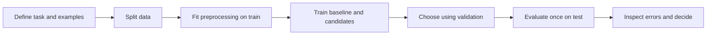

# Part 4 — Machine learning

## Chapter 18 — Learning from examples

Supervised learning starts with examples x and targets y. Training finds parameters θ for a model f so its predictions f(x; θ) fit observed targets under a loss. The goal is not merely low training loss; it is useful performance on new examples drawn from the environment where the model will be used.

A dataset usually becomes a feature matrix X and target vector y. Each row should represent the chosen unit consistently. Each feature must be available when a prediction is needed.

## Chapter 19 — Regression and classification

**Regression** predicts a number. Linear regression models a weighted sum of features. It is fast, offers an interpretable baseline, and can work well when the relationship is approximately linear. Feature transformations can model curves.

**Classification** predicts a category. Logistic regression maps a weighted sum through a sigmoid to estimate a probability for binary classification. A threshold converts that probability to a label. The threshold should reflect error costs and be chosen using validation data.

Loss functions measure error. Mean squared error is common for regression; binary cross-entropy is common for binary probability prediction. An objective may also include regularization, which penalizes overly large or complex parameter values.

## Chapter 20 — Trees and ensembles

A decision tree repeatedly splits feature space using questions. It can model non-linear interactions and is easy to inspect when small. A very deep tree can memorize noise.

A random forest trains many varied trees and averages them. Gradient boosting builds trees sequentially to correct residual error. These ensembles often perform strongly on tabular data. They still need sound splitting, tuning, interpretation, and calibration.

## Chapter 21 — Other classical methods

- k-nearest neighbors predicts from nearby examples; distance scale and storage cost matter.
- Support vector machines seek a separating boundary with a margin; kernels allow non-linear boundaries.
- Naive Bayes uses probability with a conditional-independence assumption; it can work well for text despite the simplified assumption.
- k-means groups points by distance to centroids; results depend on scaling, initialization, and chosen cluster count.
- PCA compresses dimensions by maximizing retained variance under a linear projection; it does not preserve every task-relevant detail.

## Chapter 22 — The workflow

A pipeline ties preprocessing to a model so transformations are fit correctly inside each training fold. For example, imputation and scaling must learn their values from training data only.

Start with the simplest reasonable baseline. Add complexity only when evidence shows it improves a metric that matters. Record model version, preprocessing, split, metric, and random seed.

## A worked example

For predicting apartment rent, begin with a baseline that predicts the median rent in the training set. Then fit a linear model using area and rooms, and a tree ensemble using the same split. Compare mean absolute error on validation data. Inspect neighborhoods or price ranges with large errors. Do not include the final rent contract value or a post-listing field as an input.

The result might show that a complex model has lower average error but performs much worse in one new neighborhood. That is a data coverage question, not just a model leaderboard.

## Q&A

**What is the model learning?**  
It adjusts parameters to reduce an objective on training examples. The pattern may represent real structure, shortcuts, or artifacts; validation and error analysis help tell them apart.

**Why not always use the most accurate algorithm?**  
The score may be noisy or mismatched to the task. A larger model may cost more, be harder to explain, or fail under distribution change. Choose based on benefit and operating constraints.

**What is regularization?**  
A method that discourages complexity, often by adding a penalty to the loss or constraining the model. It can improve generalization but may also cause underfitting if too strong.

**What is the difference between a feature and an embedding?**  
A feature is an input representation; an embedding is a learned dense vector representation. Embeddings can encode useful similarity but may also carry unwanted associations.

**When should I use an ensemble?**  
When validation evidence shows it helps enough to justify added compute, complexity, and maintenance. It should still be evaluated on held-out data.