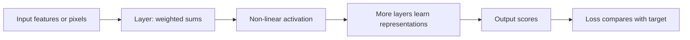

# Part 6 — Deep learning and computer vision

## Chapter 28 — A neural network as a composition of functions

A neuron computes a weighted sum z = w·x + b, then applies a non-linear activation. A layer contains many such units. Stacking layers creates a function that can represent increasingly complex transformations.

The input layer receives numbers. Hidden layers form intermediate representations. The output layer produces scores or predictions. A tensor is a multi-dimensional array; images, batches, and model weights are commonly represented as tensors.

## Chapter 29 — Loss, backpropagation, and optimization

A forward pass calculates predictions. A loss function compares predictions with targets. Backpropagation applies the chain rule to calculate how each parameter contributed to that loss. An optimizer updates parameters using those gradients.

One training step is:
1. take a batch of examples;
2. calculate predictions;
3. calculate loss;
4. calculate gradients;
5. update parameters;
6. repeat.

An epoch is one full pass through the training set. Batch size, learning rate, initialization, architecture, and optimizer affect training. Plot training and validation loss; diverging curves often indicate overfitting.

## Chapter 30 — Regularization and transfer learning

Weight decay discourages large weights. Dropout randomly removes some activations during training. Data augmentation creates realistic variations. Early stopping stops when validation performance ceases improving. These methods target overfitting in different ways.

Transfer learning starts from a model trained on a larger or related dataset. Freeze some layers and train a small output head, or fine-tune more layers. This can reduce compute and data needs. It can also transfer bias or fail when domains differ. Check model license and training-data context.

## Chapter 31 — Computer vision

A color image is a height × width × channel tensor. Convolution applies a small learned filter across locations, detecting local patterns such as edges. Pooling or strided operations reduce spatial size. Deeper layers combine local features into broader patterns.

Vision tasks:
- classification: one or more labels per image;
- detection: labels and bounding boxes;
- segmentation: class per pixel or region;
- tracking: link objects over frames;
- generation: create or transform images.

Labels must match the task. For detection, image-level labels are not sufficient; boxes are needed. For segmentation, masks are needed. Dataset splits should prevent near-identical frames or images from leaking across partitions.

Residual connections add a block's input to its transformed output. They help information and gradients flow through deeper networks. The ResNet paper describes this residual-learning design; see [primary paper](https://arxiv.org/abs/1512.03385).

## Worked example: image classifier

Suppose a model sorts photos into three plant species. First inspect class counts, image sizes, duplicates, and photographer overlap. Resize or crop consistently. Build a simple baseline. Fine-tune a pretrained image encoder. Report per-class precision/recall and inspect examples where species are visually similar. State that the app is an educational classifier, not a botanical authority.

## Q&A

**Why are activations needed?**  
Without non-linear activations, stacking linear layers collapses to one linear transformation and cannot express complex decision boundaries.

**What does backpropagation do?**  
It calculates parameter gradients efficiently through a network. It does not itself choose the learning rate or guarantee good generalization.

**Why use a pretrained model?**  
It may already encode useful visual patterns, reducing data and compute. Check domain mismatch, licenses, and whether the transfer is actually beneficial.

**Why use augmentation?**  
It teaches invariance to transformations that are realistic for the task. An unrealistic transformation can change the label or introduce unwanted assumptions.

**Why inspect image splits for duplicates?**  
Near-duplicates let the model appear to generalize when the same source image or video frame is already in training.