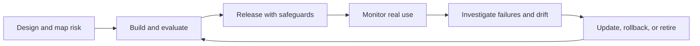

# Part 11 — Production and responsible AI

## Chapter 53 — A model is part of a service

A working model file is not a production system. A service also needs input validation, access control, data processing, versioning, latency management, logging, failure handling, user communication, and an owner.

Batch prediction is suitable when results can be prepared periodically. Online prediction responds to a request and must meet latency and availability goals. Edge deployment runs near a device and may have strict memory, power, and privacy limits.

Choose model size and architecture with these constraints in mind. Track inference time, memory, throughput, and cost, not only accuracy.

## Chapter 54 — MLOps and reproducibility

MLOps combines software engineering and operational practices for ML. Track:
- source-code version;
- data provenance and version;
- training configuration and random seed;
- feature and preprocessing definitions;
- model artifact and evaluation;
- deployment version and rollback path.

A reproducible pipeline separates data validation, training, evaluation, packaging, release, and monitoring. Model registries and experiment trackers help, but clear records matter more than a particular platform.

## Chapter 55 — Monitoring and feedback loops

Monitor system health and model behavior:
- latency, errors, throughput, and spend;
- input missingness and ranges;
- prediction distributions and confidence;
- delayed outcome metrics;
- user corrections and overrides;
- subgroup error patterns where appropriate.

Data drift means inputs change. Concept drift means the relationship between inputs and target changes. A model may stay online while becoming wrong. Define alert owners and actions, including rollback, retraining, or disabling predictions.

Feedback can change the data being collected. If a recommendation changes what users see, then the next dataset reflects the earlier recommendation system. Monitor the loop, not just individual predictions.

## Chapter 56 — Safety, security, and privacy

Threat modeling asks what can go wrong, who can cause it, what resources are exposed, and what controls reduce the risk. Protect secrets, restrict tools and data, validate inputs, rate-limit, and avoid logging unnecessary personal information.

For generative systems, test prompt injection, sensitive data leakage, unsafe tool calls, and refusal behavior. A prompt cannot enforce permission: enforce it in application code.

Use lawful, documented data and model assets. Understand licenses and retention terms. Keep a deletion and incident-response process.

## Chapter 57 — Responsible governance and user impact

Responsible AI considers validity, reliability, safety, security, accountability, transparency, privacy, and fairness across the lifecycle. Ask who benefits, who bears errors, who is represented, and who can contest an outcome.

The NIST AI Risk Management Framework organizes work into Govern, Map, Measure, and Manage. It is a living framework; check the current version and companion materials when using it. It supports risk conversations rather than replacing domain judgment.

Human review requires time, training, authority, and evidence. Otherwise a reviewer may simply approve automation. Explain intended use, limitations, appeal paths, and fallback behavior to affected users.

## Lifecycle diagram

## Q&A

**What is the difference between data drift and concept drift?**  
Data drift changes the input distribution. Concept drift changes how inputs relate to the target. Both can degrade performance but need different diagnosis.

**Does a human in the loop make a system safe?**  
Only if the human has time, training, authority, and enough evidence to challenge the model. Human presence alone can create false confidence.

**Why version data and models?**  
So a result can be tied to its inputs and reproduced or rolled back. Without versions, a changed dataset or feature pipeline can silently change behavior.

**Should all prompts be logged?**  
No. Logs should serve a defined purpose, protect sensitive information, follow retention limits, and be accessible only to authorized people.

**When should an AI feature be disabled?**  
When severe failures, harm, compromised controls, or unacceptable performance exceed predefined limits. Assign an owner and define the rollback path before release.

## Practice

1. Draw the service architecture for your capstone from user input to model output.
2. Define three operational metrics and three model-quality metrics.
3. Describe what alert should fire if inputs shift or error rate rises.
4. Threat-model one attack involving private data, prompt injection, or tool access.
5. Write a rollback and human-review plan for a severe failure.

## Mastery check

You can identify a system owner, versions, monitoring signals, security boundaries, privacy limits, user communication, and a concrete rollback path.