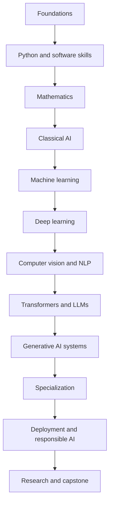

# Full AI Course: organized by subject

This course is for a learner starting with little or no AI background. Each subject has its own folder so you can see what belongs to Python, mathematics, AI, ML, NLP, LLMs, and other fields.

There are **13 subject folders, 46 core lessons, and 8 optional advanced chapters**. The beginner-to-builder path covers 62 tracked core topics; the [advanced study path](ADVANCED_PATH.md) adds deeper theory and systems topics. Each chapter is a lesson with explanations, examples, Q&A, practice, and a mastery check. Some technical topics include diagrams.

## Learning path

## Subject folders

| Subject | Main topics |
| --- | --- |
| [Foundations](./foundations/README.md) | AI basics, terminology, task framing, study method |
| [Python and software foundations](./python/README.md) | Python, algorithms, Git, SQL, environments, APIs |
| [Mathematics](./mathematics/README.md) | Algebra, linear algebra, probability, statistics, calculus, optimization |
| [Classical AI](./ai/README.md) | Search, planning, logic, constraints, uncertainty, game reasoning |
| [Machine learning](./ml/README.md) | Problem framing, supervised and unsupervised learning, evaluation |
| [Deep learning](./deep-learning/README.md) | Neural networks, backpropagation, regularization, transfer learning |
| [Computer vision](./computer-vision/README.md) | Images, CNNs, vision tasks, transfer learning, evaluation |
| [Natural language processing](./nlp/README.md) | Text processing, embeddings, sequence models, language tasks |
| [Large language models](./llm/README.md) | Transformers, tokenization, pretraining, inference, adaptation |
| [Generative AI](./generative-ai/README.md) | Prompting, RAG, tool use, agents, image/audio/video, evaluation |
| [AI specializations](./specializations/README.md) | Reinforcement learning, recommendations, time series, graphs, robotics |
| [AI engineering and responsibility](./engineering/README.md) | MLOps, deployment, monitoring, security, privacy, governance |
| [Research and capstone](./research/README.md) | Paper reading, reproducible experiments, advanced study, capstone |

## Practice, projects, and mastery

- [Runnable labs](../labs/README.md) — 22 local exercises, from Python and gradient descent through attention, retrieval, and monitoring.
- [Project ladder](../projects/README.md) — six staged projects with acceptance criteria and a [shared grading rubric](../projects/RUBRIC.md).
- [Mastery checks](../assessments/MASTERY_CHECKS.md) and [100-point scorecard](../assessments/MASTERY_SCORECARD.md) — answer explanations and evidence-based gates.

## Expanded notes and vocabulary

The chapter pages link to long-form, beginner-oriented explanations in [Expanded deep-study notes](DEEP_GUIDES.md). Each subject folder has its own guide with topic explanations, definitions, worked examples, Q&A, and practice. Use the cross-course [AI glossary](GLOSSARY.md) when you meet an unfamiliar term.

## Advanced study path\n\nThe core path gives a broad beginner-to-builder foundation. The [optional advanced study path](ADVANCED_PATH.md) fills gaps in learning theory, causal experiments, probabilistic models, data systems, efficient inference, speech/search, foundation-model systems, and robust safety testing.\n\n## AI/ML field reference

Use the [AI/ML Field Reference](AI-ML-FIELD-REFERENCE.md) for a cross-course glossary, a practical guide to major model families, their strongest use cases, and the tradeoffs behind data, training, inference, memory, and engineering efficiency.

## Continue into AI backend engineering

If your backend background is Java/Spring Boot, follow the [Java + Spring AI course](https://github.com/kavinash0310/ai-backend-engineer/tree/main/course/java-spring) and its [roadmap](https://github.com/kavinash0310/ai-backend-engineer/blob/main/ROADMAP.md). It covers production API/security design, Spring AI integration, PostgreSQL and RAG, durable jobs, tests/evaluation, cloud operations, and senior system design. Use this course for AI/ML theory and keep Java for your backend implementation.

## Which programming languages?

Start with **Python** for AI notebooks and the scientific ecosystem. Learn **SQL** and basic shell commands. If you already build backend services with Java/Spring Boot, keep Java for the service layer and use the linked [AI Backend Engineer Java path](https://github.com/kavinash0310/ai-backend-engineer/tree/main/course/java-spring); Python is still useful for model/data examples. Add JavaScript/TypeScript only if you need a web interface. C/C++ are optional for performance, embedded AI, or robotics. Do not try to learn all languages at once.

## How to use the course

1. Start with [Foundations](./foundations/README.md).
2. Complete each folder's chapters in order and do the practice before moving on.
3. Use the topic checklist in [PROGRESS.md](../PROGRESS.md).
4. Read the folder README to see prerequisites and next steps.
5. Use the [source guide](./SOURCES.md) for official documentation and primary research papers.

The core beginner-to-builder route takes roughly **9–15 months at 6–8 focused hours per week**. Advanced specialization and expertise require continuing projects, deeper theory, paper reading, and experience with real data and users over time. This course prepares you for that work; it does not promise expertise from reading alone.

## What counts as learning

For each chapter, aim to explain the idea in plain language, solve a small example, implement or use the method, evaluate it fairly, and name a failure mode. Finishing a page without being able to do those things is a signal to practice more.

## Read the course as a textbook

The lesson files provide a guided chapter sequence. Open the [textbook index](./TEXTBOOK.md) for 13 longer subject volumes with worked examples, deeper explanations, and practice.
