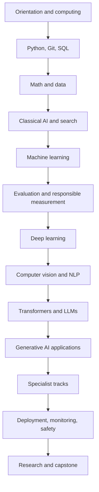

# Full AI Course: beginner to advanced

A subject-by-subject course for someone starting with little or no AI background. It connects programming, mathematics, data, classical AI, machine learning, deep learning, NLP, LLMs, other AI fields, and production practice.

**Important:** this course can take you from beginner to capable AI builder and prepare you for advanced study. Becoming an expert is an ongoing process of building, reading, evaluating, and specializing over years; no single course can guarantee expertise.

## The learning map

## Course chapters

| Part | Subject | Chapters |
| --- | --- | --- |
| [0. Foundations](00-foundations-and-study-method.md) | What AI is, how to learn it, how to choose tasks | 1–2 |
| [1. Computing and Python](01-computing-programming-python.md) | Computer basics, terminal, Git, Python, SQL, algorithms | 3–7 |
| [2. Mathematics](02-mathematics-for-ai.md) | Algebra, linear algebra, probability, statistics, calculus, optimization | 8–12 |
| [3. Data and classical AI](03-data-and-classical-ai.md) | Problem framing, data quality, search, logic, planning | 13–17 |
| [4. Machine learning](04-machine-learning.md) | Supervised, unsupervised, model families, training workflow | 18–22 |
| [5. Evaluation](05-evaluation-and-model-selection.md) | Splits, metrics, leakage, calibration, robustness, fairness | 23–27 |
| [6. Deep learning and vision](06-deep-learning-and-vision.md) | Neural nets, gradients, CNNs, transfer learning, vision tasks | 28–32 |
| [7. NLP](07-nlp-and-language-models.md) | Text processing, embeddings, language tasks, encoder/decoder models | 33–37 |
| [8. Transformers and LLMs](08-transformers-and-llms.md) | Attention, transformer blocks, pretraining, tuning, inference | 38–42 |
| [9. Generative AI systems](09-generative-ai-systems.md) | RAG, tool use, agents, image/audio generation, safety | 43–47 |
| [10. Other AI fields](10-other-ai-fields.md) | Reinforcement learning, recommendations, time series, graphs, robotics | 48–52 |
| [11. Production and responsible AI](11-production-and-responsible-ai.md) | MLOps, serving, monitoring, security, privacy, governance | 53–57 |
| [12. Advanced study and capstone](12-advanced-study-and-capstone.md) | Research methods, specialization, capstone, career paths | 58–62 |

The chapter numbers make it easier to track progress. Each part explains the ideas, shows where they fit, includes review Q&A with answers, and gives practice.

## How long it takes

- **Core beginner-to-builder route:** roughly 9–15 months at 6–8 focused hours per week.
- **Advanced specialization:** add sustained project work, deeper math, paper reading, and experience with real users and data.
- Go at checkpoint pace, not calendar pace. Repeat difficult topics and take breaks.

## The languages and tools

| Tool or language | Why it is here | When |
| --- | --- | --- |
| Python | Main language for data, ML, deep learning, and AI applications | Start |
| SQL | Query structured data from databases | After Python basics |
| Shell / command line | Run programs, move files, manage environments | Alongside Python |
| Git and GitHub | Save versions and share projects | From the start |
| NumPy and pandas | Arrays and tables | Data module |
| scikit-learn | Classical ML workflows | ML module |
| PyTorch | Neural-network training | Deep-learning module |
| JavaScript / web basics | Optional interface for a browser-based demo | After core |
| C or C++ | Optional performance, robotics, or systems specialization | Advanced track |

Do not try to learn several programming languages at once. Start with Python; add SQL because data work often uses databases. Add other languages only when a project needs them.

## How to study

For each chapter:

1. Read a short section and explain it back in plain language.
2. Work through the example by hand or in code.
3. Answer the questions before checking the answers.
4. Complete one exercise and record what failed.
5. Revisit the mastery check later, without looking at notes.

Aim for about 60–70% hands-on practice and 30–40% reading or watching. When asking an AI assistant for help, request a hint or explanation, then verify the result yourself.

Use the [course progress tracker](../PROGRESS.md), the [project template](../templates/project-template.md), and the [source guide](SOURCES.md). The original [lesson notes](../lessons/README.md) provide additional short explanations and Q&A.

## What completion means

Finishing the pages is not the same as knowing the material. For each major topic, you should be able to:
- explain the idea without memorized jargon;
- implement a tiny example;
- choose a suitable method and a baseline;
- evaluate it on data not used to tune it;
- explain its failure modes and limits;
- write down a reproducible project report.