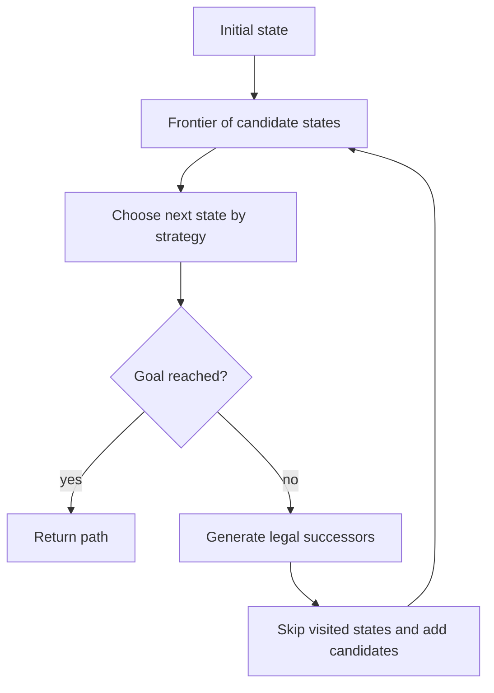

# Chapter 1 — Search and planning

> **Book-length subject volume:** For expanded explanations, worked examples, review questions, and practice, read the [ai textbook](TEXTBOOK.md).

> **Expanded lesson notes:** Open the [full subject notes](DEEP_NOTES.md) for step-by-step explanations, key vocabulary, worked examples, Q&A, and practice.

## Represent the problem

Search is useful when you can describe possible states and actions. A problem definition contains:
- initial state;
- legal actions;
- transition rule;
- goal test;
- path cost.

For a maze, a state is a cell, actions move to a neighboring cell, the goal is the exit, and cost can be the number of moves. If the representation omits a wall or movement rule, the algorithm may return an invalid path.

## Choose a search strategy

Breadth-first search (BFS) explores states by increasing number of steps. With equal action costs it finds a shortest path. It uses a queue and a visited set.

Depth-first search (DFS) follows one path deeply before backtracking. It can use less memory but may take a long route or fail to terminate in an infinite graph without cycle checks.

Dijkstra's algorithm handles non-negative variable costs by expanding the currently cheapest path. A* uses f(n)=g(n)+h(n): cost already paid plus a heuristic estimate of remaining cost. If h never overestimates the true remaining cost, A* can preserve optimality under standard conditions.

## Complexity and memory

If the average number of actions per state is b and search depth is d, the tree can grow approximately like b^d. A small increase in depth can multiply the work. Good state design, duplicate detection, heuristics, and pruning matter.

A shortest path is not always the best plan. Real planning may include time windows, resource use, uncertainty, or multiple goals. Make the cost function represent what the user values.

## Search flow

## Questions and answers

**When does BFS guarantee the fewest steps?**  
When all actions have equal cost and the graph is explored by increasing depth.

**What is a heuristic?**  
A cheap estimate of distance or cost remaining to the goal. It guides search but may be inaccurate.

**Why does A* use both g and h?**  
g reflects known work already spent; h estimates work remaining. Using only h may prefer a path that has already cost too much.

**Why is a visited set important?**  
It prevents loops from repeatedly expanding the same state and wasting time.

## Practice and mastery

Implement BFS on a small grid, then add weighted steps and Dijkstra. Add Manhattan distance to create an A* heuristic. Compare states expanded, path cost, and whether your heuristic can overestimate.